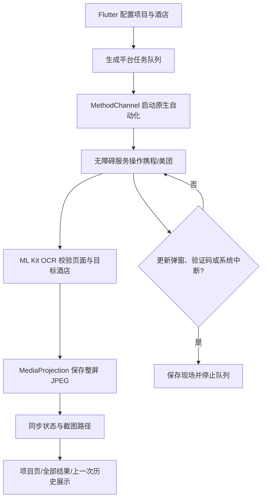

# 酒店监控 APP

一款面向安卓手机的酒店价格巡检工具。APP 使用 Android 无障碍服务模拟人工操作携程和美团，按监控项目依次搜索主体酒店与竞对酒店，并保存包含酒店名称和房价的真实页面截图。

当前版本是“页面截图版”。APP 不根据 OCR 猜价格，价格结论以最终截图为准；OCR 只用于识别页面、匹配酒店名称和校验目标页面。

> 发布包：[查看最新 Releases](https://github.com/304939905/hotel-monitor-app/releases/latest)
> 当前源码：`1.0.0+1`，最后功能基线为 2026-07-27。

## 重要说明

- 本项目依赖安卓无障碍服务和屏幕录制授权，只适合在明确授权、可控的个人测试手机上运行。
- 不调用携程或美团接口，不抓包，不运行后台爬虫，不自动破解验证码。
- 遇到验证码时必须由用户人工完成；遇到锁屏、系统中断或页面无法可靠识别时会停止，不用猜测结果继续采集。
- 当前主要在小米 8 SE（Android 9）和小米 MI 8（Android 10）上验证。Android 11 以上、不同厂商系统及平台新版页面仍需真机回归。
- 携程、美团的界面、弹窗和风控规则会变化。项目不是保证长期可用的价格接口。

## 功能简介

### 监控项目管理

- 每个项目包含项目名称、城市、一个主体酒店和零个或多个竞对酒店。
- 同一家酒店可分别配置美团名称和携程名称，兼容两个平台的酒店命名差异。
- 主体酒店和竞对酒店都允许只填写一个平台；平台名称为空时自动跳过。
- 新增或编辑项目时支持全屏“批量添加”，使用固定三行分组快速录入多家酒店。
- 编辑项目不会重置创建时间、今日查看次数和已有截图记录。

### 自动采集

- 单项目采集：依次处理该项目中已启用平台、且平台名称非空的主体酒店和竞对酒店。
- 全量采集：主页“全”按钮依次处理所有项目。
- 携程流程：进入全局搜索、选择“酒店”分类、识别目标卡片、确认酒店名称后保存结果页截图。
- 美团流程：定位目标酒店、进入详情页、核验完整酒店名、执行筛选刷新、等待房价稳定后保存详情页截图。
- 每次完成或被安全条件中断时，尽量保留现场截图与状态，供人工复核。

### 结果与历史

- 结果按项目和平台展示，截图可点击进入全屏缩放查看。
- 状态包括“采集成功”“满”“待人工核验”“采集错误”“更新弹窗阻挡”“需要人工验证”。
- “总 · 查看全部结果”按项目汇总所有当前结果。
- 项目页“历史”只展示紧邻的上一次采集。
- APP 永远只保留“当前”和“上一次”两代截图，更早文件在下一轮开始时自动清理。

### 安全保护

- 更新弹窗只允许点击“暂不更新、以后再说、取消、关闭”等安全选项，绝不点击“立即更新”。
- 无法安全关闭更新弹窗时保存现场截图并停止整次队列。
- 识别到 Yoda、Captcha、Geetest 等验证码页面时停止自动点击，保留未完成任务。
- 用户人工完成验证码后，可继续未完成任务；已完成结果不会重跑。
- 锁屏键和无障碍服务 `onInterrupt()` 都是紧急停止信号。中断后不恢复当前步骤，也不继续剩余队列。

## 工作流程



## 主要技术结构

| 层 | 技术 | 职责 |
|---|---|---|
| 界面与数据 | Flutter、Dart | 项目管理、批量导入、任务发起、结果与历史展示 |
| 原生自动化 | Kotlin、Android AccessibilityService | 页面状态机、平台点击、搜索与安全停止 |
| 屏幕采集 | Android MediaProjection | 保存真实页面 JPEG |
| 页面识别 | Google ML Kit 中文 OCR | 页面判断、酒店名称匹配、目标校验 |
| 本地存储 | SharedPreferences、APP 私有目录 | 项目配置、状态、截图路径和两代历史 |

核心源码：

- `lib/pages/home_page.dart`：主页、全量采集、验证码续跑和结果同步。
- `lib/pages/monitor_page.dart`：单项目采集与截图结果页。
- `lib/pages/all_results_page.dart`：全部项目当前结果汇总。
- `lib/widgets/project_dialogs.dart`：项目编辑和全屏批量添加。
- `android/app/src/main/kotlin/com/hotelmonitor/hotel_monitor_app/HotelAccessibilityService.kt`：携程/美团自动化状态机。
- `android/app/src/main/kotlin/com/hotelmonitor/hotel_monitor_app/ScreenCaptureService.kt`：截图和 OCR。

## 安装与使用

### 1. 下载 APK

不要从 Git 仓库下载 APK。APK 会随功能版本发布到 [GitHub Releases](https://github.com/304939905/hotel-monitor-app/releases/latest)，避免源码仓库被大二进制反复撑大。

- 近年主流 64 位安卓手机：优先选择文件名带 `arm64-v8a` 的 APK。
- 较老的 32 位设备：选择文件名带 `armeabi-v7a` 的 APK。
- 不确定架构时，可执行 `adb shell getprop ro.product.cpu.abi` 查看。

每个 Release 同时提供 `SHA256SUMS.txt`，下载后可校验文件完整性。

### 2. 安装

可直接把 APK 传到手机安装。使用 ADB 时：

```powershell
adb install -r .\hotel-monitor-app-arm64-v8a-v1.0.0.apk
```

当前 Release APK 使用调试签名，适合本机测试和侧载，不适合发布到应用商店。

### 3. 首次配置

1. 保持手机解锁、亮屏，并安装携程和美团。
2. 打开酒店监控 APP。
3. 在“手机自动化”卡片中点击“开启无障碍权限”，找到“酒店监控自动化”并启用。
4. 新增监控项目，填写项目名称、城市、主体酒店和竞对酒店的平台名称。
5. 第一次开始采集时，按系统提示允许屏幕录制。
6. 进入项目，选择平台并点击“采集最低起价”。

### 4. 推荐首次验证顺序

1. 用一家酒店、一个平台做单酒店测试。
2. 通过后再运行一个项目的携程和美团。
3. 最后再运行主页“全 · 采集所有项目”。
4. 检查截图是否完整包含目标酒店名称和房价。
5. 遇到验证码或更新弹窗，先处理现场，再重新采集。

## APP 按钮功能

### 主页

| 按钮或入口 | 功能 |
|---|---|
| 右上角 `+` | 打开“新增监控项目”窗口。 |
| `开启无障碍权限` | 无障碍未开启时出现，跳转系统无障碍设置。 |
| `打开携程测试` | 只尝试打开携程，用于检查安装和跳转是否正常。 |
| `自动进入酒店` | 无障碍开启后可用，执行携程自动化连通性测试。 |
| `清除` | 把所有项目的“今日查看”计数归零并保存。 |
| `总 · 查看全部结果` | 按项目汇总所有当前采集状态和截图。 |
| `全 · 采集所有项目` | 开始采集全部项目；点击后显示 3 秒倒计时确认窗口。 |
| 倒计时窗口 `取消` | 取消全量采集。 |
| 倒计时窗口 `立即确认` | 不等待倒计时，立即开始。 |
| 长按 `全 · 采集所有项目` | 选择全量任务正常完成后的提示铃声。 |
| 项目卡片 | 进入该项目的采集和结果页面，并增加今日查看次数。 |
| 项目卡片三点菜单 | 提供“编辑项目”和“删除项目”。 |
| `新增项目` / `新增监控项目` | 项目列表为空时显示，用于创建首个项目。 |
| `重新读取` | 本地项目数据读取失败时重新加载。 |

### 验证码待处理卡片

| 按钮 | 功能 |
|---|---|
| `继续未完成任务` | 用户人工完成验证码后，继续此前保留的剩余任务。 |
| `查看现场` | 查看触发验证码时保存的现场截图。 |
| `放弃剩余任务` | 清除验证码后的未完成任务；已完成结果保留。 |

### 新增/编辑监控项目

| 按钮或控件 | 功能 |
|---|---|
| `批量添加` | 打开独立全屏文本编辑页，批量录入主体酒店和竞对酒店。 |
| 美团与携程名称相同 | 勾选后只填写一次名称，并同时用于两个平台。 |
| `添加竞对酒店` | 将当前填写的竞对酒店加入项目列表。 |
| 竞对酒店右侧 `×` | 从当前编辑中的竞对列表中删除该酒店。 |
| `取消` | 关闭窗口，不保存本次表单修改。 |
| `保存` | 校验项目名称、城市和主体酒店名称后保存项目。 |

### 批量添加全屏页

固定格式为三行一组：

```text
主体酒店
美团名称
携程名称

A
美团名称
携程名称

B
美团名称
携程名称
```

- “主体酒店”段可以省略；省略时只追加竞对。
- `A`、`B`、`C` 等只是分组字母，不会保存成酒店名。
- 某个平台没有名称时填写 `1`，导入后转换为空。
- 一家酒店两个平台都填 `1` 时拒绝导入。
- 点击右上角 `添加` 只回填项目表单；仍需点击项目窗口“保存”。
- 左上角关闭按钮放弃本次批量输入。

### 单项目页

| 按钮或控件 | 功能 |
|---|---|
| `美团` / `携程` 筛选按钮 | 启用或停用该项目对应平台，并立即保存项目配置。 |
| `采集最低起价` | 执行当前项目所有有效酒店和已启用平台的截图任务。采集期间按钮显示“采集中...”。 |
| `历史` | 打开“上次采集结果”，只展示紧邻上一次的所有截图。 |
| 结果截图 | 点击进入全屏查看，可双指缩放。 |
| 返回箭头 | 返回主页。 |

### 全部项目结果

| 入口 | 功能 |
|---|---|
| 项目分组 | 展示项目名称、城市、结果数量和当前截图。 |
| 结果截图 | 点击进入全屏查看。 |

## 开发过程

### 2026-07-15：项目接管与基础模型

- 接管 Flutter Android 项目，确定使用闲置手机和无障碍服务模拟人工操作。
- 将酒店拆分为主体和竞对，并分别保存携程名和美团名。
- 增加“两平台名称相同”和空平台自动跳过规则。
- 在小米 8 SE、Android 9 上开始携程真机测试。

### 2026-07-16 至 07-18：自动化流程成型

- 携程改为搜索结果页确认酒店和起价；美团改为进入详情页并刷新筛选。
- 增加多项目、组合批量和双列卡片兼容。
- 增加满房、错误和等待人工核验状态。
- 增加锁屏和无障碍中断紧急停止。
- 修复携程未知详情页启动、酒店名称换行、价格格式和 OCR 卡片范围等问题。

### 2026-07-18：从文字识别版切换到截图版

- 用户明确价格以真实页面截图为准，OCR 不再生成价格结论。
- 接入 MediaProjection 整屏 JPEG 保存。
- 新增两代历史轮换，只保留当前和上一次。
- 新增“总”“全”按钮，并改为独立整行，降低误触。

### 2026-07-19：验证码保护

- 真机遇到美团 Yoda 验证码。
- 增加验证码页面识别、现场截图、警告音、队列停止和未完成任务持久化。
- 禁止自动破解；人工验证后可继续剩余任务。

### 2026-07-27：批量录入与资料整理

- 新增全屏批量添加酒店，支持可选主体、A/B/C 竞对分组和 `1` 转空平台。
- 解析器、界面和存储测试累计达到 21 项。
- 整理当前状态、主资料库、开发日志、运行手册和冻结备份索引。

### 2026-11-16：GitHub 仓库整理

- 将源码、测试和稳定文档纳入 Git 管理。
- 排除临时调试截图、ADB 日志、构建目录、旧代码副本和 APK。
- 建立中文 README、按钮说明与发布附件规范，并发布按 ABI 拆分的测试 APK。

完整过程见 [`docs/DEVELOPMENT_LOG.md`](docs/DEVELOPMENT_LOG.md)。

## 构建与测试

环境要求：

- Flutter SDK 可正常执行 `flutter doctor`。
- Dart SDK 满足 `pubspec.yaml` 中的 `^3.12.2`。
- Android SDK 和 Java 17。

```powershell
flutter pub get
flutter analyze
flutter test
flutter build apk --debug
flutter build apk --release --split-per-abi
```

Debug APK 输出到：

```text
build/app/outputs/flutter-apk/app-debug.apk
```

## GitHub 附件与下载流量安排

本仓库采用“源码仓 + Release 二进制”的结构：

- Git 只保存源码、测试、文档和小型文本配置。
- APK/AAB、构建目录、设备截图、UI XML、运行日志和临时诊断文件不进入 Git。
- 可安装包发布到 GitHub Releases，不修改 Git 历史即可独立下载。
- APK 按 ABI 拆分，用户只下载设备需要的架构，避免下载通用包的重复原生库。
- 每次 Release 附带 `SHA256SUMS.txt`，不重复上传 GitHub 自动生成的源码 ZIP。
- 不使用 Git LFS 保存 APK；这样普通克隆不会拉取整个版本的安装包。

详细规则见 [`docs/RELEASE_POLICY.md`](docs/RELEASE_POLICY.md)。

## 项目资料

- [当前开发状态](docs/CURRENT_STATUS.md)
- [主资料库](docs/PROJECT_KNOWLEDGE_BASE.md)
- [开发日志](docs/DEVELOPMENT_LOG.md)
- [开发与真机操作手册](docs/RUNBOOK.md)
- [发布与附件规范](docs/RELEASE_POLICY.md)
- [冻结版本索引](docs/BACKUP_INDEX.md)
- [资料总索引](docs/README.md)

## 使用边界

本项目用于个人授权设备上的界面自动化与截图留证。使用者应遵守携程、美团的服务规则、当地法律和所在组织的合规要求，不得用于自动破解验证码、绕过平台安全机制、批量骚扰或未经授权的数据收集。

仓库当前未附带开源许可证。公开可见不等于自动授予复制、修改、分发或商业使用权；如需复用代码，请先取得作者许可。
